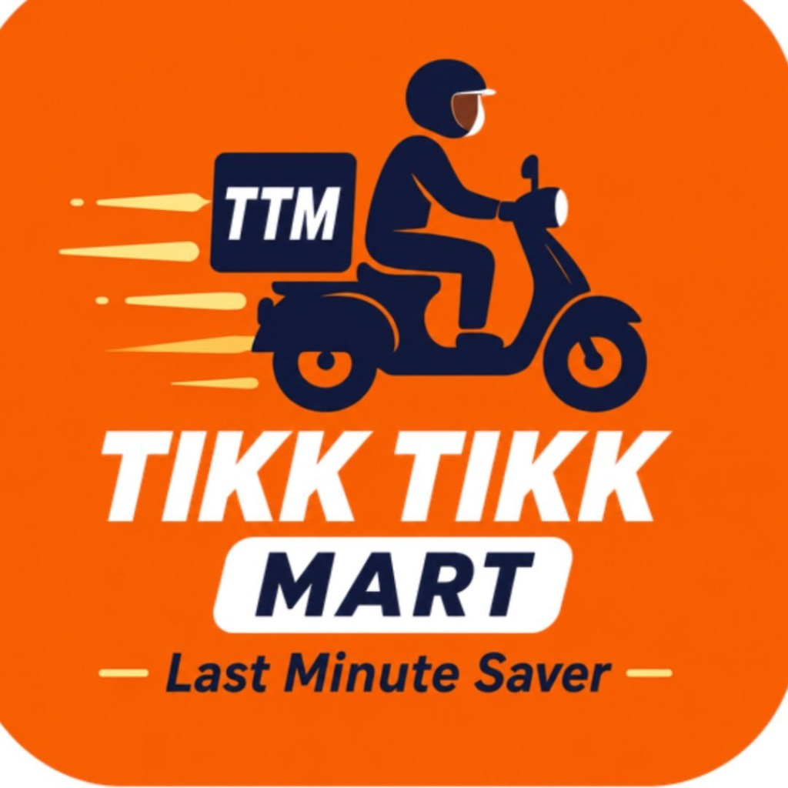

# TIKK TIKK MART — Last Minute Saver ⚡

> **10-Minute Hyperlocal Quick-Commerce Platform**  
> Fresh groceries, daily essentials, dark store inventory routing, real-time rider dispatch, and instant customer checkout.



---

## 🌟 Key Features

### 🛍️ Customer Experience (Mobile-First Blinkit Design)
- **10-Minute Delivery ETA**: Dynamic serviceability checker with dark store polygon lookup.
- **Visual Category Showcase**: Instant search, category carousels, pack size steppers, and express badges.
- **Cart & Instant Bill Breakdown**: Zero-latency bill calculation with MRP discount, delivery fee, handling charge, and small cart fee.
- **Interactive Checkout**: Address picker with Google Maps pin selector, delivery instruction chips, Razorpay integration, and Cash-on-Delivery (COD).
- **Live Order Tracking**: 4-step live fulfillment stepper with store packing, rider assignment, and 4-digit delivery OTP verification.

### 🚴 Delivery Partner Terminal (`/rider`)
- **Shift & Duty Toggle**: Online/Offline shift switch with screen wake lock and battery-efficient GPS pinging.
- **Partner Tier & Multipliers**: Bronze, Silver, and Gold tiers with +10% payout multiplier and daily bonus progression.
- **Safety & Helmet Verification**: AI camera selfie check modal before starting delivery shifts.
- **Active Order Stepper**: Store pickup PIN, navigation shortcuts, customer call links, and OTP auto-validation.
- **Passbook & Metrics**: Today's earnings breakdown, completed trips history, and COD cash balance management.
- **Emergency SOS**: 1-click access to National Emergency (`112`), Ambulance (`108`), and Fleet Control.

### 🏬 Dark Store Operations (`/store`)
- **Picker & Packer Workflow**: Order queue filtered by store ID with instant item verification and barcode packing.
- **Inventory & Shelf Management**: Real-time stock counts, price management, and low-inventory restock alerts.

### 🛡️ Admin & Fleet Control (`/admin`)
- Dark store polygon geo-fencing, rider onboarding approval, catalog taxonomy, and platform analytics.

---

## 🛠️ Tech Stack

- **Framework**: Next.js 15 (App Router, React 19)
- **Styling**: Tailwind CSS v4, Lucide Icons
- **State Management & Querying**: TanStack React Query v5, Zustand
- **Database & Auth**: Supabase PostgreSQL with PostGIS serviceability & Row Level Security (RLS)
- **Payments**: Razorpay Payment Gateway & Cash on Delivery (COD)
- **Geolocation**: Google Maps Places & Maps API

---

## 🚀 Getting Started

### 1. Prerequisites
- Node.js 18+
- npm, yarn, or pnpm
- Supabase project credentials

### 2. Installation
```bash
git clone https://github.com/eduniketanpvtltd/Tikktikkmart.git
cd Tikktikkmart
npm install
```

### 3. Environment Setup
Copy `.env.example` to `.env.local` and configure your credentials:
```bash
cp .env.example .env.local
```

### 4. Run Development Server
```bash
npm run dev -p 3001
```

Open [http://localhost:3001](http://localhost:3001) in your browser.

---

## 📜 License
Private & Confidential © 2026 EduNiketan Pvt Ltd / TikTikMart.
